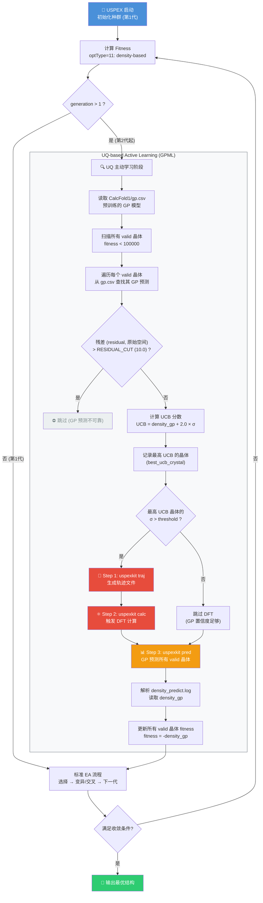
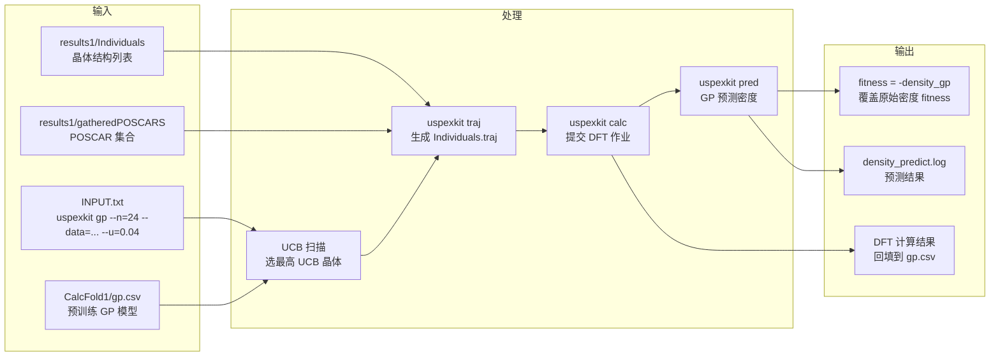

# USPEX 310 进化算法 + 高斯过程机器学习 (GPML) 主动学习

> 姊妹篇 `docs/uq_active_learning.md` 是同一循环的英文描述；`docs/expected_improvement.md`
> §2 给出 1.96σ 的口径，`docs/algorithm_review.md` §2.2/§2.3 给出 in-sample 重预测与
> residual 阈值。本文「数据流」一节另记 `ei-report` 读哪些落盘文件，以及一次缺点归因。
> 文中引用以**函数名**为准，代码行号会随改动漂移。

## 算法机理流程图



## 核心公式

### UCB (Upper Confidence Bound) 采集函数

$$UCB = \hat{\mu}(x) + \kappa \cdot \hat{\sigma}(x)$$

其中：
- $\hat{\mu}(x)$ = GP 预测的密度 (`density_gp`，gp.csv col6)
- $\hat{\sigma}(x)$ = GP 预测的不确定性 (`uncertainty`，gp.csv col7)
- $\kappa = 2.0$ (exploration-exploitation 平衡系数)

### 关键决策逻辑

```
if UCB_crystal.σ > u_threshold:
    → 触发 DFT 计算 (探索高不确定性区域)
else:
    → 跳过 DFT (GP 已有足够置信度)
```

### 残差过滤

```
if residual > RESIDUAL_CUT:   # 10.0, 原始 10 维 ReaxFF 特征空间
    → 该晶体不参与 UCB 竞争 (GP 预测质量太差)
```

## 数据流



### 运行产物与 `ei-report` 的读取口径（2026-11-08 修订）

上面数据流图里的 `density_predict.log` 是 **`uspexkit pred` 的运行产物**，不是报告的
数据源。`gpevo/tools/ei_report.py` 只解析运行目录里已经落盘的文件，各图元的来源如下：

| 图 / 量 | 数据源 | 解析入口 |
|---|---|---|
| 结构密度 ρ_ML（灰点、best-so-far） | `results<N>/Individuals` | `parse_individuals()` |
| **GP 均值 μ 与不确定度**（紫色方块、误差棒、σ 曲线） | **`results<N>/OUTPUT.txt`** 每代 SUMMARY 表尾的 `Enthalpy(GP) UC Density(GP) UC Residual` | `parse_output_gp()` |
| DFT 参考密度（红菱形） | `results<N>/density.log` | `parse_density_log()` |
| EI 选中的 id | `results<N>/ei.log`（回退运行根目录） | `parse_ei_log()` |
| labels / LOO RMSE（绿柱、橙线） | `log` 或 `OUTPUT.txt` 的 `GP learning curve` 行 | `parse_learning_curve()` |

**口径要点**：

- OUTPUT.txt 的 `UC` 列已经是 $1.96\sigma$（95% 置信半宽，见
  `docs/expected_improvement.md` §2、§7），而 `density_predict.log` 的 `std_den`
  是**原始 σ**。`parse_output_gp()` 把 `UC / 1.96` 存成 `std`，下游 `build_summary()` /
  `_ei_series()` 再乘 `ei_report.py` 的 `UNCERT_SCALE = 1.96` 还原，因此误差棒仍是
  ±1.96σ，与 EI 侧的口径一致。`residual` 列沿用共享阈值 `RESIDUAL_CUT = 10.0`
  （见 `docs/algorithm_review.md` §2.3）。
- **不用 `density_predict.log` 的两个理由**：其一，`uspexkit pred` 写的是**加入新标签
  之后的事后重预测**（in-sample），会人为把校准做得好看，`docs/algorithm_review.md` §2.2
  的 GP 校准刻意避开它；其二，它是逐代重写的快照，不保证覆盖每一代（下面这次归因
  就是）。OUTPUT.txt 的每代 SUMMARY 表是 **`uspexkit gp()` 当时**的预测（该代新增的
  DFT 标签尚未并入训练集），代代都有。
- labels / LOO RMSE 这一支实际常为空：写这些行的 `_log_learning_curve()` 走
  `console_print`（`gpevo/log_utils.py`），只进终端、不写进 `log` / `OUTPUT.txt`；
  而 `parse_learning_curve()` 又只在 `run_dir`（`-p` 指定的目录）找这两个文件，
  当 `-p` 指向运行根目录时 OUTPUT.txt 还在 `results<N>/` 里。所以 learning 图
  往往只剩紫色的 σ 曲线。

### 一次缺点归因：`ct22/results3` 的 22–24 代（2026-11-08）

**现象（改动前的图）**：`ei_report_convergence.png` 的 22/23/24 代只有红色 DFT 菱形
（1.8787 g/cm³），没有紫色 GP 预测方块；`ei_report_learning.png` 的 x 轴甚至只到 21 代。

**归因**（只读核对，不是绘图把点滤掉了）：

- `results3/density_predict.log`：761 行、id 1066–2008、mtime 11-07 22:19，停在 21 代附近；
- `results3/ei.log` 的 gen 22/23/24 选中 2085 / 2240 / 2255，三个 id 都不在这份 predict 里；
- 但 `results3/density.log` 里这三个 id 都有 DFT 值，`Individuals` 里也都有（ρ≈1.945），
  `OUTPUT.txt` 对应代的 SUMMARY 表里也都有 μ=1.875、UC≈0.0314、Residual≈0.002。

于是 `build_summary()` 从 predict 取到的 `density_gp` / `sigma` 是 NaN，而 `density`
（Individuals）与 `dft`（density.log）都有值：convergence 的紫方块（只收 `density_gp`
有限的项）被排除、红菱形（只要求 `dft` 有限）照画；learning 的 `sigma_mean` 同样为 NaN，
又因为 `GP learning curve` 行没有落进 `log` / `OUTPUT.txt`，`plot_learning()` 的
`has_data` 对这三代全 False，整代被 `plot_gens` 剔除。

**结论与处置**：这是**数据层缺行**。`pred` 的数据源整体改为 OUTPUT.txt 的
`parse_output_gp()` 后实测，22/23/24 三代都补上了紫色 GP 方块与 σ 数据点，
`tests/test_ei_report.py` 17 个单测通过。影响面：
`uspex_tnt/uspex_gp/results1/OUTPUT.txt` 没有 GP 表，指向该目录的报告会没有
GP 预测值；其余 `ct22/results*` 与 `tnt22/results1` 的 OUTPUT.txt 都有表。

## 索引体系

| 索引 | 范围 | 存储位置 | 用途 |
|------|------|---------|------|
| `bodyCount` | 全局累加 (如 268, 271...) | `POP_STRUC.POPULATION(i).Number` | gp.csv col2, calc/pred --ids, density_predict.log col1 |
| `valid_idx` | 当前代 1..N | `find(fitness < 100000)` | POP_STRUC 本地索引 |
| `Individuals` 行号 | 跨代累加 (1-based) | Individuals 文件 | 与 Individuals.traj 一致 |

## 参数说明

| 参数 | 来源 | 默认值 | 说明 |
|------|------|--------|------|
| `ncpu` | `--n=` | 8 | 并行计算核数 |
| `dat_dir` | `--data=` | `'data'` | GP 训练数据目录 |
| `u_threshold` | `--u=` | 0.04 | 不确定性阈值，超过则触发 DFT |
| `kappa` | 硬编码 | 2.0 | UCB 探索系数 |
| `residual_max` | 硬编码 | 10 | 残差过滤阈值 |
| `CalcFold` | 硬编码 | `CalcFold1` | GP 模型存储目录 |